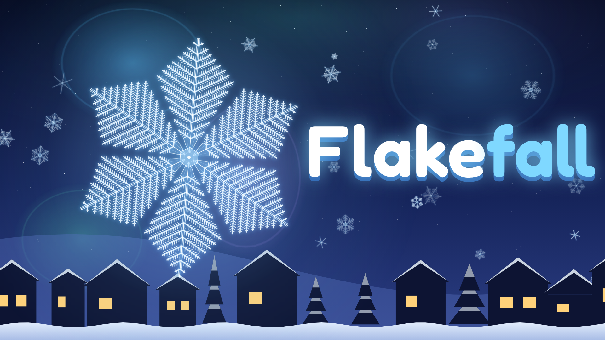

# Flakefall ❄

**Te vagy a hópehely. Az ég, amin keresztülesel, növeszti a kristályodat. Nincs két egyforma.**

HTML5 böngészős játék, a [CrazyGames](https://www.crazygames.com) követelményei szerint elkészítve (SDK v3, reklámok, felhőmentés, mobil + asztali).



## Az ötlet

Egy apró jégkristályként zuhansz a felhőkből a földig. Kormányzod magad, és **a levegő, amin átrepülsz, valós időben alakítja a kristályod formáját**. Ez a valódi hópehely-fizikára épül (Nakaya-diagram):

| Levegő | Valóságban | A játékban |
|---|---|---|
| 🔵 Frost Mist (−15 °C, párás) | dendrites ágak | oldalágak nőnek; a köd szívében páfrányszerű al-ágak |
| 🟣 Plate Haze (−2 / −12 °C) | lapos lemezek | széles, szektoros lemez-karok |
| 🟢 Needle Drift (−5 °C) | tűk | hosszú, vékony tüskék |
| ⚪ Cloud Droplets | zúzmara (rime) | ráfagyó cseppek → *Rimed* / *Graupel* |
| 🟠 Warm Air | olvadás | olvad a kristály, ha elfogy, esőcsepp leszel |

A kristály tehát **a repülésed lenyomata**: a közepe a zuhanás elején nőtt, a karok vége a végén. Ezért egyetlen futás sem ad két egyforma pelyhet. Madarak, drónok és lámpások letörhetik a karjaidat (a szimmetria pontot ér), a szél oldalra sodor. A végén a fekete bársonytáblára kell landolnod a „tökéletes fotóért” (×2). Ez Wilson Bentley valós módszere volt, ő fotózta le az első hópelyheket.

A fotót a játék automatikusan elmenti az **albumba**. 13 valódi hópehelytípust lehet összegyűjteni (Stellar Dendrite, Sectored Plate, Graupel, Twelve-branched Star, Triangular Crystal…), mindegyikhez egy igaz tudományos érdekesség tartozik.

### Miért egyedi?

Mielőtt kiválasztottam, más ötleteket is ellenőriztem. Ezek már léteznek, ezért elvetettem őket:

- **világítótorony-fénnyel hajókat terelni**: a CrazyGames-en is van ilyen (*Beacon Bay*);
- **a Holddal irányítani az árapályt**: *Tricky Tides*, *Watashi no Tsuki*;
- **a Nap mozgatásával árnyékot vetni egy vámpírnak**: *Umbralate*, *Wandering Shadows*, *Sunburn*.

A hópelyhes témában a legközelebbi találatok:

- **Flake Maker**: kristálynövesztő szimuláció, de nincs benne irányítás;
- **Snowfall**: hópelyhet kormányzol és akadályokat kerülsz, de a pehely nem nő.

Olyan játékot nem találtam, ahol **az útvonalad maga az ecset, ami a kristályt formálja**, és a végén gyűjthető, valós típusba sorolt „fotót” kapsz.

## Irányítás

- **Egér**: a pehely követi a kurzort · **A / D** vagy **← →**
- **Érintőképernyő**: húzd az ujjad bárhol (relatív húzás, az ujjad nem takarja el a pelyhet)
- **Esc / P**: szünet

## Tartalom

- 4 ég: *Quiet Village* → *Mountain Pass* (szél, sasok, zúzmara) → *City Lights* (meleg szellőzők, lámpások, drónok) → *Aurora Tundra* (sarki fény, arany Twin Spark). Új eget fajok felfedezésével lehet feloldani.
- 13 gyűjthető hópehelyfaj, 5 fejleszthető képesség (Workshop), személyes rekordok egenként.
- Eljárásgenerált pályák, generatív zene és hangok WebAudio-val, hangfájlok nélkül.
- **A teljes játék 157 KB** (zip: 87 KB, 8 fájl).

## CrazyGames megfelelés

| Követelmény | Állapot |
|---|---|
| SDK v3 (`crazygames-sdk-v3.js`), `init()` minden hívás előtt | ✅ `src/sdk.js` |
| `loadingStart` / `loadingStop` a betöltés körül | ✅ |
| `gameplayStart` / `gameplayStop`: zuhanás kezdete/vége, szünet, újraélesztés, menü | ✅ automatikus teszt ellenőrzi, hogy váltakoznak |
| Midgame reklám csak természetes szünetben (két zuhanás között, „Next flake” / „Menu”), az első játék előtt nincs | ✅ |
| Rewarded reklám csak önkéntesen, jelölt gombbal: *Refreeze* (újraélesztés), *Double frost* | ✅ |
| Reklám alatt a hang némítva, a játék szünetel | ✅ |
| `settings.muteAudio` + `addSettingsChangeListener` (felülírja a játékbeli hangbeállítást) | ✅ |
| `happytime()` csak nagy pillanatnál (új faj felfedezése) | ✅ |
| Mentés az SDK **data** moduljával (felhő, eszközök között szinkronizál), localStorage csak tartalék | ✅ |
| Kezdeti letöltés ≤ 20 MB (mobil kezdőlap) / ≤ 50 MB | ✅ 0,16 MB |
| Fájlszám ≤ 1500 | ✅ 8 |
| Nincs külső link, más portál logója, más reklámhálózat, saját teljes képernyő gomb | ✅ |
| Angol nyelv | ✅ |
| Mobil: érintés, álló és fekvő tájolás | ✅ 390×844, 800×450, 1280×720 tesztelve |
| A nyilak / szóköz nem görgetik az oldalt az iframe-ben, nincs jobb-klikk menü | ✅ |
| Olvasható 800×450-es iframe-ben (devicePixelRatio 1) | ✅ |
| Borítóképek: 1920×1080, 800×1200, 800×800 | ✅ `covers/` |
| SDK nélkül is működik (adblock, más oldal) | ✅ tesztelve |

## Feltöltés a CrazyGames-re

1. `release/flakefall-crazygames.zip`: ezt kell feltölteni (az `index.html` a zip gyökerében van).
2. A [Developer Portalon](https://developer.crazygames.com) új játék → **HTML5**.
3. **Kapcsold be a „Progress Save” opciót** a beküldésnél, különben a data modul (mentés) ki van kapcsolva. Ilyenkor a játék localStorage-ra vált, de a CrazyGames a data modult várja.
4. Borítók: `covers/cover-landscape-1920x1080.png`, `covers/cover-portrait-800x1200.png`, `covers/cover-square-800x800.png`.
5. Javasolt adatok:
   - **Title:** Flakefall
   - **Short description:** Steer a falling snowflake – the sky you fall through grows its crystal. No two flakes are ever alike.
   - **Description:** You are a tiny ice crystal falling from the clouds. Fly through blue Frost Mist to sprout branches, lavender Plate Haze for wide plates and mint Needle Drift for long spikes – but avoid warm air, or you'll melt into a raindrop! Dodge birds and drones that snap your arms, ride the wind, and land on the black velvet board for a perfect photo. Every flake you photograph is classified as a real snow crystal type and saved to your album. Collect all 13 species, unlock 4 skies and upgrade your crystal in the Workshop.
   - **Controls:** Mouse / A-D / Arrow keys to steer · Touch: drag anywhere · Esc/P: pause
   - **Tags:** casual, snow, winter, relaxing, collection, arcade, christmas, physics, 1 player, mobile
6. Ötlet: a téli / karácsonyi szezon előtt érdemes beküldeni, mert ekkor a CrazyGames szezonális kategóriákat emel ki.

## Fejlesztés

```bash
npm install
npm run dev      # fejlesztői szerver: http://localhost:8080 (mentéskor újraépít)
npm run build    # dist/ + release/flakefall-crazygames.zip
npm test         # fej nélküli böngészős teszt (Playwright): asztali, telefon, 800×450, mind a 4 ég, SDK nélkül
npm run covers   # covers/*.png újrarajzolása
```

A `?ffdebug` URL-paraméter egy teszt-hookot kapcsol be (`window.__ff`). A `?muteAudio=true` a CrazyGames némítási beállítását szimulálja helyben.

### Szerkezet

```
public/            index.html, style.css, betűtípusok (OFL)
src/
  main.js          állapotgép, menük, HUD, SDK-folyamat (betöltés, gameplay, reklámok)
  sdk.js           CrazyGames SDK v3 wrapper, tartalék megoldásokkal
  crystal.js       a kristálynövekedés modellje + renderelés (egy kar, 6× lebélyegezve)
  world.js         egy zuhanás: generálás, fizika, akadályok, landolás, rajzolás
  species.js       13 hópehelytípus, osztályozás, pontozás
  skies.js         a 4 ég (pálya) és a levegőtípusok
  audio.js         generatív zene + hangeffektek (WebAudio)
  scene.js         menü háttér, „fotó” renderelés
  input.js, save.js, sprites.js, util.js
tools/             build, smoke-test, borító-generátor, SDK mock a tesztekhez
covers/            CrazyGames borítóképek
release/           feltölthető zip
```
